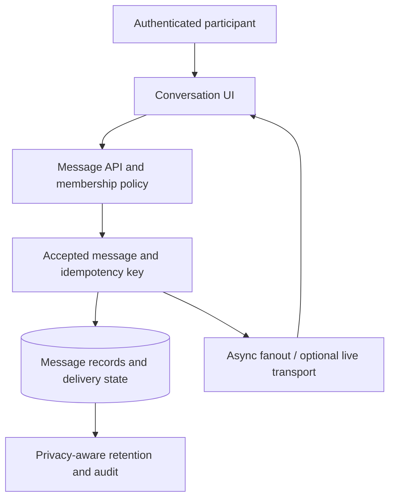

# Chatline — Communication and Workflow Architecture — Reference Architecture

## What is known

The repository currently describes a lightweight communication/workflow application at a high level. It does not publish messaging backend source, account deployment data or real chat histories.

## Engineering question

Reliable multi-party communication must separate message creation from delivery, manage ordering and retries, and enforce conversation membership before every read/write.

## Illustrative flow (not a production diagram)

## Design invariants and risk controls

- Only authorized conversation members may see or send messages; server must check membership for each operation.
- Delivery and read acknowledgments differ from durable message acceptance; show separate states.
- Retries require idempotency keys to prevent accidental duplicates and provide stable ordering.
- Retention, attachment access, blocking and export rules must be specified and tested before a real user launch.

## Synthetic scenario to test in future

Synthetic out-of-order delivery: message B reaches a device before A; client displays consistent server ordering and does not duplicate A when it is retried.

## Failure mode / trade-off

A UI showing “sent” before server acknowledgment creates misleading delivery guarantees.

## Evidence required before confirming features

- A versioned implementation artifact or test contract, reviewed against original source.
- A deterministic fixture that exercises negative permissions, errors and recovery.
- A dated CI run linked to the fixture rather than to documentation formatting alone.
- Authorized sanitized images/measurements; never actual account or customer data.

This file should be updated when real evidence becomes publishable; until then these are **design notes only**. See [README.md](README.md) and [ROADMAP.md](ROADMAP.md).
